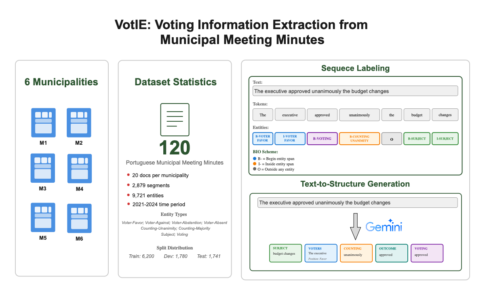

# VotIE: Information Extraction from Meeting Minutes

[](https://arxiv.org/abs/2601.03997)
[](https://creativecommons.org/licenses/by-nc-nd/4.0/)
[](https://www.python.org/downloads/)

Code and results for the EACL 2027 paper **"VotIE: Information Extraction from Meeting Minutes"**.

VotIE is a span-level task: given a segment of Portuguese municipal meeting minutes, find the arguments
of each voting event, namely what was voted on, how, the outcome, and which councillors voted for,
against, abstained or were absent. This repository contains the benchmark splits, the eight
discriminative baselines, the three generative baselines (Gemini 2.5 Pro, GPT-5.5, AMALIA 8B), and the
predictions and evaluations behind the paper's tables.

- **Paper:** [arxiv.org/abs/2601.03997](https://arxiv.org/abs/2601.03997)
- **Demo:** [huggingface.co/spaces/Anonymous3445/VotIE-demo](https://huggingface.co/spaces/Anonymous3445/VotIE-demo)
- **Model:** [huggingface.co/liaad/DeBERTa-CRF-VotIE](https://huggingface.co/liaad/DeBERTa-CRF-VotIE) (mDeBERTa-v3 + CRF, the best system)
- **Dataset:** CitiLink-Minutes, [doi.org/10.25747/7KG6-1K22](https://doi.org/10.25747/7KG6-1K22)

<div align="center">
    
</div>

## Contents

1. [Quick start](#quick-start)
2. [Task](#task)
3. [Getting the data](#getting-the-data)
4. [Installation](#installation)
5. [Running the experiments](#running-the-experiments)
6. [Results](#results)
7. [Repository layout](#repository-layout)
8. [License, acknowledgments and citation](#license)

## Quick start

Try the model in the browser with the [demo](https://huggingface.co/spaces/Anonymous3445/VotIE-demo), or locally:

```bash
pip install torch transformers==4.57.3 pytorch-crf==0.7.2 sentencepiece
python scripts/quick_start.py
```

```python
from transformers import AutoModel, AutoTokenizer

repo = "liaad/DeBERTa-CRF-VotIE"
tokenizer = AutoTokenizer.from_pretrained(repo)
model = AutoModel.from_pretrained(repo, trust_remote_code=True).eval()

text = ("A proposta foi aprovada por maioria, com os votos a favor dos eleitos do PS "
        "e a abstenção dos vereadores do PSD.")

print(model.extract_entities(text, tokenizer))          # {type: [{text, start, end}, ...]}
for w in model.decode(tokenizer=tokenizer, text=text):  # word-level BIO labels
    print(w["word"], w["label"], w["confidence"])
```

Documents longer than 512 subwords are processed in overlapping windows (50-subword overlap).

## Task

The schema has 12 argument types in five groups:

| Group | Types |
|---|---|
| Event | `VOTING` (the trigger), `SUBJECT` (what was decided) |
| Voters | `VOTER-FAVOR`, `VOTER-AGAINST`, `VOTER-ABSTENTION`, `VOTER-ABSENT` |
| Outcome | `COUNTING-UNANIMITY`, `COUNTING-MAJORITY` |
| Secret-ballot counts | `COUNT-FAVOR`, `COUNT-AGAINST`, `COUNT-BLANK` |
| Procedure | `VOTING-METHOD` |

`COUNT-AGAINST` has no test instances, so macro averages are taken over the other 11 types.

The benchmark uses 120 minutes from six Portuguese municipalities (2021–2024): 2,885 segments and
10,694 spans.

| Code | Municipality | Code | Municipality |
|---|---|---|---|
| M01 | Alandroal | M04 | Fundão |
| M02 | Campo Maior | M05 | Guimarães |
| M03 | Covilhã | M06 | Porto |

- **Standard split:** chronological within each municipality, 72/24/24 documents (1,803 / 553 / 529
  segments). In training, segments with rare types (`COUNT-BLANK`, `COUNT-FAVOR`, `VOTING-METHOD`) or
  with more than one voting event are oversampled (2,463 training rows).
- **Leave-one-municipality-out (LOMO):** test on all segments of one municipality, train and validate on
  the other five (85/15, stratified; folds M01–M06).

## Getting the data

The corpus is not redistributed here. CitiLink-Minutes is available from the INESC TEC Research Data
Repository, where access must be requested:
**[doi.org/10.25747/7KG6-1K22](https://doi.org/10.25747/7KG6-1K22)**.

`data/split_info.json` lists which documents belong to the train, development and test splits. Once
you have the dataset, place the per-municipality JSON files (`Alandroal.json`, `Campomaior.json`, …,
`Porto.json`) in `data/citilink-dataset/` and build the splits:

```bash
python scripts/dataset_generation/convert_new_citilink_to_spans.py   # -> data/citilink_spans_v2/
python scripts/dataset_generation/generate_v6_multi_vote_aware.py    # -> data/citilink-votie/ (standard split)
python scripts/dataset_generation/create_lomo_splits_v6.py           # -> data/citilink-votie-lomo-splits/M01..M06
```

Each segment is one JSON line with character-offset spans; BIO tags are derived at load time:

```json
{"id": "...", "text": "...", "municipality": "M06", "document_id": "...", "is_multi_vote": false,
 "spans": [{"start": 17, "end": 148, "label": "SUBJECT", "text": "..."}]}
```

The annotation guidelines for the voting layer are in `voting_layer_annotation_guidelines.pdf`.

## Installation

```bash
git clone https://github.com/LIAAD/VotIE.git
cd VotIE
python -m venv venv && source venv/bin/activate
pip install -r requirements.txt
```

The BiLSTM baseline needs the Portuguese fastText vectors: download
[`cc.pt.300.bin.gz`](https://dl.fbaipublicfiles.com/fasttext/vectors-crawl/cc.pt.300.bin.gz), unpack it, and set
`VOTIE_FASTTEXT_PATH` to its location.

The generative baselines read their settings from a `.env` file at the repository root:

```bash
GEMINI_KEY=...                     # Gemini 2.5 Pro
IAEDU_API_KEY=...                  # GPT-5.5, accessed through the IAEDU institutional gateway
IAEDU_ENDPOINT=...                 #   gateway stream URL
IAEDU_CHANNEL_ID=...               #   (or IAEDU_CREDENTIALS=key1:channel1,key2:channel2)
AMALIA_BASE_URL=http://host:8000   # AMALIA 8B served with vLLM
```

`python scripts/llm_extraction/verify_extraction_setup.py` checks the setup without making API calls.

## Running the experiments

### Discriminative baselines

One YAML per baseline in `configs/`: CRF, BiLSTM-CRF, and BERTimbau-Large, mDeBERTa-v3 and
XLM-RoBERTa, each with a linear and a CRF head. The Transformer encoders use learning rate 5e-5, batch
size 8, and up to 10 epochs with early stopping on development macro F1. The encoder-CRF models were
trained with seeds 42, 13 and 123, the other baselines with seed 42.

```bash
# train -> predict -> evaluate on the standard split
python scripts/run_pipeline.py --config configs/deberta_crf.yaml --name deberta_crf_s42 --seed 42

# one LOMO fold (configs/municipality_experiments/, generated by scripts/make_lomo_configs.py)
python scripts/run_pipeline.py --config configs/municipality_experiments/deberta_crf_M01.yaml \
    --name deberta_crf_M01_s42 --seed 42
```

Each run writes `predictions.jsonl` and `evaluation.json` (exact and relaxed match) to
`results/runs/<model>/<name>/`. To aggregate runs into the paper's tables, place each evaluation file at `results/standard/<model>/seed_s<SEED>_evaluation.json` (LOMO:
`results/lomo/<model>/<M0X>_seed_s<SEED>_evaluation.json`) and run:

```bash
python scripts/aggregate_seeds.py --latex results/table2_lomo_body.tex
```

### Generative baselines

All three use [LangExtract](https://github.com/google/langextract) with the same instructions and five
fixed demonstrations (`src/llm_extraction/`; prompts in Appendix A of the paper). Output is requested
as JSON but not constrained to a schema. Predicted spans are aligned back to the text by exact
substring matching, and spans that cannot be aligned are discarded.

```bash
# standard benchmark: --strategy zero_shot or few_shot
python scripts/llm_extraction/extract_gemini_spans.py --strategy few_shot
python scripts/llm_extraction/extract_gpt_spans.py --strategy few_shot
python scripts/llm_extraction/extract_amalia_spans.py --strategy few_shot
python scripts/llm_extraction/evaluate_spans.py results/generative/gemini/few_shot.jsonl --relaxed

# leave-one-municipality-out
python scripts/llm_extraction/run_cross_municipality.py --provider gemini --strategy few_shot

# reliability and cost report (Appendix C)
python scripts/llm_extraction/consolidate_standard_benchmark.py --score
```

Gemini and AMALIA decode at temperature 0; the gateway does not expose temperature for GPT-5.5. None
of the three guarantees identical outputs across runs, so re-runs can differ slightly from the reported
scores.

### Evaluation

Macro-averaged entity-level precision, recall and F1. **Exact** match requires identical boundaries and
type (CoNLL); **relaxed** match requires the same type and any overlap (SemEval-2013). Encoders are scored
with `seqeval` on their subword-level BIO labels; generative outputs are scored on character offsets.

### Analyses

These scripts read the published prediction files in `results/` together with the test set.

| Script | Paper |
|---|---|
| `scripts/statistical_tests.py`, `scripts/statistical_tests_generative.py` | paired bootstrap tests (§5) |
| `scripts/error_classification.py` | error categories, Table 3 (§6) |
| `scripts/boundary_error_analysis.py` | boundary-error causes and relaxed-match recovery (§6) |

## Results

Standard benchmark, macro F1 (%) on the test set. Encoder-CRF rows are means ± std over seeds 42, 13 and
123; other rows are seed 42 or a single run.

| Model | Exact | Relaxed |
|---|---|---|
| **DeBERTa-CRF** | **93.5 ± 0.9** | **97.1 ± 1.6** |
| XLM-R-CRF | 90.7 ± 1.4 | 95.9 ± 1.3 |
| BERTimbau-CRF | 90.5 ± 1.8 | 96.2 ± 1.0 |
| BERTimbau-Linear | 90.9 | 94.8 |
| DeBERTa-Linear | 89.8 | 94.6 |
| XLM-R-Linear | 87.0 | 91.7 |
| CRF | 81.0 | 84.1 |
| BiLSTM-CRF | 69.7 | 74.6 |
| Gemini 2.5 Pro (0-shot) | 63.1 | 88.0 |
| Gemini 2.5 Pro (5-shot) | 62.8 | 88.9 |
| GPT-5.5 (5-shot) | 59.4 | 86.2 |
| GPT-5.5 (0-shot) | 53.9 | 82.7 |
| AMALIA 8B (5-shot) | 35.6 | 49.2 |
| AMALIA 8B (0-shot) | 25.9 | 42.7 |

Leave-one-municipality-out, exact-match macro F1 (%) on the held-out municipality (selected rows; the
paper reports all baselines):

| Model | M01 | M02 | M03 | M04 | M05 | M06 | Mean |
|---|---|---|---|---|---|---|---|
| DeBERTa-CRF | 60.1 | **73.4** | 63.9 | 71.5 | **62.7** | 28.1 | **60.0** |
| XLM-R-CRF | 59.7 | 56.1 | 51.2 | 63.6 | 57.8 | 29.6 | 53.0 |
| BERTimbau-CRF | 58.8 | 55.0 | 58.1 | 46.5 | 42.6 | 34.6 | 49.3 |
| Gemini 2.5 Pro (5-shot) | **79.8** | 53.4 | 53.0 | 55.5 | 47.2 | **52.2** | 56.9 |

### Result files

| Paper | Files |
|---|---|
| Table 1 | `results/standard/<model>/seed_s<SEED>_{predictions.jsonl,evaluation.json}`, `results/generative/<model>/{zero,few}_shot{.jsonl,_evaluation.json}`; aggregated in `results/seed_aggregate_summary.json` |
| Table 2 | `results/lomo/<model>/<M0X>_seed_s<SEED>_{predictions.jsonl,evaluation.json}`, `results/generative/lomo/gemini/`; LaTeX body in `results/table2_lomo_body.tex` |
| Significance tests | `results/statistical_tests.json`, `results/statistical_tests_lomo.json`, `results/statistical_tests_generative.json` |
| Table 3 | `results/error_classification_results.json` |
| Appendix C | `results/generative/STANDARD_BENCHMARK.md` |

## Repository layout

```
configs/                     one YAML per baseline; municipality_experiments/ holds the 48 LOMO configs
data/split_info.json         document-level train / development / test assignment
src/
  data/                      span <-> BIO conversion, dataset loading
  models/                    CRF, BiLSTM-CRF, BERTimbau / mDeBERTa / XLM-R with linear or CRF heads
  llm_extraction/            Gemini, GPT-5.5 and AMALIA extractors, prompts, span alignment, scoring
  evaluation/                entity-level metrics
  trainer.py, bilstm_trainer.py
scripts/                     training, prediction, evaluation, aggregation, statistics, error analysis
  dataset_generation/        CitiLink-Minutes JSON -> span JSONL -> standard and LOMO splits
  llm_extraction/            generative extraction, cross-municipality runs, reports
results/
  standard/                  in-domain predictions and evaluations per model and seed
  lomo/                      leave-one-municipality-out predictions and evaluations per model, fold and seed
  generative/                generative predictions and evaluations (standard and LOMO), reliability report
tests/
```

<a name="license"></a>
## License

Released under [CC BY-NC-ND 4.0](https://creativecommons.org/licenses/by-nc-nd/4.0/); see [LICENSE](LICENSE).
The CitiLink-Minutes corpus is distributed separately under its own terms.

## Acknowledgments

This work is funded by national funds through FCT – Fundação para a Ciência e a Tecnologia, I.P., under
the support UID/50014/2025 ([doi.org/10.54499/UID/50014/2025](https://doi.org/10.54499/UID/50014/2025)).
It was also supported by FCT I.P. under Project 2026.00030.AIVLAB.DEUCALION at the Deucalion
supercomputer, jointly funded by EuroHPC JU and Portugal.

## Citation

```bibtex
@inproceedings{evans2027votie,
  title     = {{VotIE}: Information Extraction from Meeting Minutes},
  author    = {Evans, Jos{\'e} Pedro and Cunha, Lu{\'i}s Filipe and Silvano, Purifica{\c{c}}{\~a}o and
               Jorge, Al{\'i}pio and Guimar{\~a}es, Nuno and Nunes, S{\'e}rgio and Campos, Ricardo},
  booktitle = {Proceedings of the 2027 Conference of the European Chapter of the Association for Computational Linguistics (EACL)},
  year      = {2027},
  eprint    = {2601.03997},
  archivePrefix = {arXiv},
  url       = {https://arxiv.org/abs/2601.03997}
}
```
